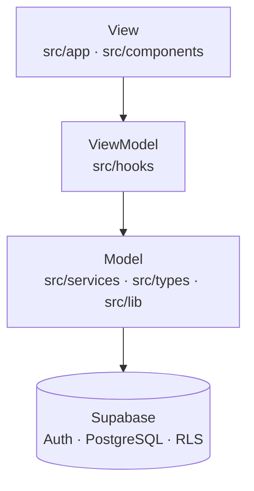

# Diario de sueños

Aplicación móvil para registrar sueños, clasificarlos por estado de ánimo y asociarlos con símbolos recurrentes. Está construida con Expo y Supabase, y su desarrollo se apoyó en servidores **MCP (Model Context Protocol)** conectados a un agente de IA.

- Login


- Bienvenida
  


- Lista


- Formulario


## Qué hace

- **Cuentas privadas.** Registro e inicio de sesión con correo y contraseña. La confirmación del correo se hace con un enlace que abre la app directamente.
- **CRUD de sueños.** Título, relato, fecha, estado de ánimo (tranquilo, lúcido, raro o pesadilla) e intensidad de 1 a 5.
- **CRUD de símbolos.** Elementos que se repiten en los sueños (agua, una casa, una caída), con su significado. El nombre es único por usuario.
- **Relación entre ambos.** Cada sueño puede tener varios símbolos, y la lista los muestra como etiquetas.
- **Aislamiento por usuario.** Cada cuenta ve solo sus datos, garantizado por seguridad a nivel de fila (RLS) en la base de datos.
- **Interfaz de vidrio.** Fondo con degradado y halos, tarjetas con desenfoque real en Android, tipografía Fraunces y Manrope, y una animación Lottie distinta por estado de ánimo.

## Tecnologías

| Área | Herramientas |
|---|---|
| Framework | Expo SDK 57, React Native 0.86, React 19.2, TypeScript |
| Navegación | Expo Router (rutas por archivos, grupos `(app)` y `(auth)`, `Stack.Protected`) |
| Datos y autenticación | Supabase (Auth, PostgreSQL, RLS) con `@supabase/supabase-js` |
| Estilos | Uniwind (Tailwind CSS v4 para React Native) |
| Efectos visuales | `expo-blur`, `expo-linear-gradient`, `react-native-svg`, `react-native-reanimated` |
| Animaciones | `lottie-react-native` |
| Iconos y tipografía | `lucide-react-native`, Fraunces y Manrope (Google Fonts) |
| Compilación | EAS Build (APK) |

## Arquitectura: MVVM adaptado a React Native

El proyecto sigue MVVM. En React no existen clases ViewModel con enlace de datos, así que el **ViewModel se implementa como custom hooks**: guardan el estado de la pantalla y exponen las acciones que la vista consume.



| Capa MVVM | Carpeta | Responsabilidad |
|---|---|---|
| **View** | `src/app/`, `src/components/` | Pantallas y componentes de interfaz. No llaman a Supabase. |
| **ViewModel** | `src/hooks/` | `useAuth`, `useSuenos`, `useSimbolos`: estado, carga, errores y acciones. |
| **Model** | `src/services/`, `src/types/`, `src/lib/` | Acceso a datos, tipos generados de la base de datos y cliente de Supabase. |

### Patrones de diseño usados

| Patrón | Dónde |
|---|---|
| Repository / Service | `src/services/suenos.ts`, `simbolos.ts`, `auth.ts` (único lugar que habla con Supabase) |
| Custom Hook como ViewModel | `src/hooks/useSuenos.ts`, `useSimbolos.ts` |
| Provider / Context | `AuthProvider` en `src/hooks/useAuth.tsx` |
| Route Guard | `Stack.Protected` en `src/app/_layout.tsx` |
| Composición de componentes | `GlassCard`, `GradientBackground`, `Boton`, `Campo`, reutilizados en todas las pantallas |

## Estructura del proyecto

```
src/
├── app/
│   ├── _layout.tsx            # raíz: fuentes, sesión y guardas de ruta
│   ├── (auth)/                # sin sesión
│   │   ├── login.tsx
│   │   ├── registro.tsx
│   │   └── confirm.tsx        # destino del enlace de confirmación (deep link)
│   └── (app)/                 # con sesión
│       ├── index.tsx          # lista de sueños
│       ├── sueno/nuevo.tsx
│       ├── sueno/[id].tsx     # editar y eliminar
│       └── simbolos/
│           ├── index.tsx
│           └── nuevo.tsx      # crear y editar
├── components/                # GlassCard, Boton, Campo, SuenoForm, LottieMood...
├── hooks/                     # useAuth, useSuenos, useSimbolos
├── services/                  # auth, suenos, simbolos
├── lib/                       # supabase.ts, errores.ts
├── types/                     # database.ts (generado), index.ts
├── constants/theme.ts         # colores, tipografías y radios
└── global.css                 # tokens de Uniwind
assets/animations/             # archivos Lottie por estado de ánimo
```

## Base de datos

Tres tablas en el esquema `public`, todas con RLS activado:

| Tabla | Descripción |
|---|---|
| `suenos` | `id`, `user_id`, `titulo`, `relato`, `fecha`, `estado_animo`, `intensidad`, `created_at` |
| `simbolos` | `id`, `user_id`, `nombre` (único por usuario), `significado`, `created_at` |
| `suenos_simbolos` | Tabla de enlace (`sueno_id`, `simbolo_id`), clave primaria compuesta y borrado en cascada |

`user_id` tiene como valor por defecto `auth.uid()`, por lo que la app no lo envía: la base de datos lo completa con el usuario autenticado.

Esquema equivalente para recrearlo (el original se creó con una migración desde el MCP de Supabase; compárala en *Database → Migrations*):

```sql
create table public.suenos (
  id uuid primary key default gen_random_uuid(),
  user_id uuid not null default auth.uid() references auth.users(id) on delete cascade,
  titulo text not null,
  relato text,
  fecha date default current_date,
  estado_animo text check (estado_animo in ('tranquilo','lucido','raro','pesadilla')),
  intensidad smallint check (intensidad between 1 and 5),
  created_at timestamptz default now()
);

create table public.simbolos (
  id uuid primary key default gen_random_uuid(),
  user_id uuid not null default auth.uid() references auth.users(id) on delete cascade,
  nombre text not null,
  significado text,
  created_at timestamptz default now(),
  unique (user_id, nombre)
);

create table public.suenos_simbolos (
  sueno_id uuid not null references public.suenos(id) on delete cascade,
  simbolo_id uuid not null references public.simbolos(id) on delete cascade,
  primary key (sueno_id, simbolo_id)
);

create index on public.suenos (user_id);
create index on public.simbolos (user_id);
create index on public.suenos_simbolos (simbolo_id);

alter table public.suenos enable row level security;
alter table public.simbolos enable row level security;
alter table public.suenos_simbolos enable row level security;

create policy "suenos_propios" on public.suenos
  for all to authenticated
  using (user_id = (select auth.uid()))
  with check (user_id = (select auth.uid()));

create policy "simbolos_propios" on public.simbolos
  for all to authenticated
  using (user_id = (select auth.uid()))
  with check (user_id = (select auth.uid()));

create policy "vinculos_propios" on public.suenos_simbolos
  for all to authenticated
  using (
    exists (select 1 from public.suenos s where s.id = sueno_id and s.user_id = (select auth.uid()))
    and exists (select 1 from public.simbolos y where y.id = simbolo_id and y.user_id = (select auth.uid()))
  )
  with check (
    exists (select 1 from public.suenos s where s.id = sueno_id and s.user_id = (select auth.uid()))
    and exists (select 1 from public.simbolos y where y.id = simbolo_id and y.user_id = (select auth.uid()))
  );
```

## Uso de servidores MCP

Los MCP trabajan en tiempo de desarrollo. En ejecución, la app habla directamente con Supabase.

### Configuración

Los servidores se declaran en `.vscode/mcp.json`. Supabase y LottieFiles son remotos y se autorizan por OAuth desde el navegador, por lo que **no se guardan claves en el proyecto**.

```json
{
  "servers": {
    "supabase": {
      "type": "http",
      "url": "https://mcp.supabase.com/mcp?project_ref=TU_PROJECT_REF"
    },
    "lottiefiles": {
      "type": "http",
      "url": "https://mcp.lottiefiles.com/mcp"
    }
  }
}
```


### Qué se hizo con cada servidor

| Servidor | Uso en el proyecto | Evidencia en el repositorio |
|---|---|---|
| **Supabase** | Consulta de tablas y esquemas, migración que creó las tres tablas con sus políticas RLS, revisión de avisos de seguridad (advisors), generación de tipos TypeScript, e inserción de datos de prueba | `src/types/database.ts` (generado), migraciones en el panel de Supabase |
| **LottieFiles** | Búsqueda de animaciones públicas (nombre, id y URL del JSON) y selección de las usadas por estado de ánimo | `assets/animations/`, `src/components/LottieMood.tsx` |
| **Expo** | Consulta de la documentación de la versión instalada (SDK 57) antes de escribir código que depende de APIs de Expo | `AGENTS.md`, que fija esa regla para el agente |

### Lo que conviene saber al usar MCP

- **El MCP no usa la sesión de la app.** Opera con la cuenta de Supabase del desarrollador, con acceso de administrador al proyecto, y por eso puede escribir por encima de RLS. Al insertar datos para un usuario concreto hay que indicar su `user_id`, porque `auth.uid()` es nulo para el MCP.
- **Úsalo sobre un proyecto de pruebas**, no sobre datos reales.
- **El resultado se revisa.** Los tipos, las políticas y las consultas generadas se verificaron a mano antes de integrarlas.
- **Límites de los planes gratuitos.** LottieFiles limita las descargas mensuales de animaciones públicas, y Supabase limita los correos de confirmación que envía con su servicio integrado.

## Cómo ejecutar el proyecto

### Requisitos

- Node.js LTS reciente y npm
- Una cuenta en [Supabase](https://supabase.com) y una en [Expo](https://expo.dev)

### Pasos

```bash
git clone [enlace de GitHub]
cd diario-suenos
npm install
cp .env.example .env
```

Edita `.env` con los datos de tu proyecto (*Project Settings → API*):

```
EXPO_PUBLIC_SUPABASE_URL=https://TU_ID.supabase.co
EXPO_PUBLIC_SUPABASE_KEY=sb_publishable_...
```

Usa solo la **publishable key**, nunca la secret key. Después ejecuta el SQL de la sección anterior en el editor SQL de Supabase y arranca la app:

```bash
npx expo start -c
```

La app usa librerías con código nativo, así que para probarla en un dispositivo conviene un development build o el APK, y no depender solo de Expo Go.

### Configuración de autenticación en Supabase

En *Authentication → URL Configuration*, agrega `diariosuenos://**` a **Redirect URLs**. Es el esquema que abre la app desde el enlace de confirmación del correo.

